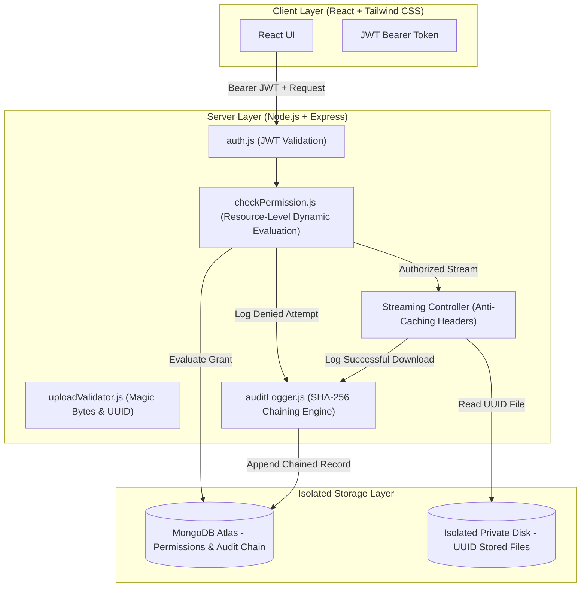

# TrustVault — Secure Document Sharing with a Cryptographic Audit Trail

[](#the-standard-it-has-to-meet)
[](#cryptographic-audit-trail)
[](#automated-security-test-suite)

> **"Build a document platform where the wrong person can never read the file, and you can prove who read it."**
>
> TrustVault is built on the premise that this is a **security engineering problem wearing the clothes of a CRUD application**. It eliminates reliance on client-side state, unrevokable pre-signed URLs, and mutable audit tables, delivering server-side zero-trust authorization on every single byte request.

---

## 🔑 Demo Seed Accounts & Roles

The system is seeded with three distinct accounts matching the challenge specifications:

| Role | Email | Password | Department | Capabilities & Boundaries |
| :--- | :--- | :--- | :--- | :--- |
| **🛡️ Administrator** | `admin@trustvault.security` | `AdminPassword@2026!` | Security & Compliance | Inspects full audit trail, triggers cryptographic integrity checks, monitors security metrics. **Separation of Duties:** Cannot read/download confidential files without an explicit owner grant. |
| **💼 Document Owner** | `owner@trustvault.security` | `OwnerPassword@2026!` | Executive & Legal | Uploads confidential documents, grants `read` / `edit` access to named users, revokes permissions immediately, deletes documents. |
| **👁️ Document Viewer** | `viewer@trustvault.security` | `ViewerPassword@2026!` | External Audit | Can only read/download documents explicitly granted to them. Cannot edit (unless given `edit`), cannot delete, cannot grant access to others. |

*Quick-Login Feature:* The login modal includes 1-click autofill buttons for each of the three accounts for instant evaluation.

---

## 🛡️ The Three Non-Negotiable Standards

### 1. Reachable ONLY by someone who was granted it
* **No Client-Side Reliance:** The React UI never decides authorization; UI button visibility is purely cosmetic.
* **Server-Decided at Request Time:** Every file access, metadata query, and download passes through `backend/src/middleware/checkPermission.js`.
* **Zero Privilege Escalation:** Administrators are barred from viewing confidential documents by default. Least Privilege / Separation of Duties is enforced at the data layer.
* **IDOR Protection:** Random object identifiers in route parameters are validated against MongoDB permissions.

### 2. You can prove who reached it (Afterwards, from the record, including refused attempts)
* **Tamper-Evident SHA-256 Chaining:** Each audit record embeds the SHA-256 digest of the immediate predecessor (`previousHash`), sequence number, ISO timestamp, actor, action, and outcome.
* **Refused Attempts Recorded:** Denied downloads, metadata reads, edits, and failed logins are immutably logged with client IP and User-Agent telemetry without leaking confidential document contents.
* **Chain Verification:** `GET /api/audit/verify` crawls the chain from genesis block to the latest entry. Any database modification, record deletion, or row insertion breaks the chain and is flagged immediately.

### 3. Taking access away works IMMEDIATELY
* **No Pre-Signed S3 URLs:** S3 pre-signed links remain valid until expiration (e.g. 15 minutes) and cannot be revoked on demand. TrustVault deliberately avoids pre-signed URLs.
* **Real-Time Streaming Engine:** Downloads stream through `GET /api/documents/:id/download`. The database permission list is evaluated at the exact millisecond of the request.
* **Zero Window of Vulnerability:** When an owner clicks "Revoke", the very next download chunk or request is immediately refused (`403 Forbidden`) and logged as `DOCUMENT_DOWNLOAD_DENIED`.

---

## 📐 Architecture & Permission Model



### Permission Model Details
1. **Ownership**: The user who uploads a document is its permanent `owner`. The owner holds exclusive rights to delete the document or grant/revoke permissions to others.
2. **Named Grants**: Access is granted exclusively to named user IDs (`read` or `edit`).
   - `read`: Can view metadata and download the file stream.
   - `edit`: Can view, download, and update document metadata (title, category, tags), incrementing the document version number.
3. **Private File Storage**: Files are stored in an isolated filesystem path (`storage/documents/`) using unguessable UUIDs (`crypto.randomUUID()`). The directory is never exposed to `express.static` or public web routes.
4. **Magic Byte Validation**: Before saving any upload, the in-memory buffer is inspected for authentic magic bytes (`%PDF-1.4`, `\x89PNG`, `\xFF\xD8\xFF`, etc.) to reject executables masquerading as documents.

---

## 🔒 Complete API Authorisation Matrix

| Endpoint | Method | Allowed Roles / Granularity | Security Enforcement & Verification | Audit Action Logged |
| :--- | :---: | :--- | :--- | :--- |
| `/api/auth/register` | `POST` | Public | Enforces strong passwords; self-escalation to `admin` clamped to `viewer` | `AUTH_REGISTER_SUCCESS` |
| `/api/auth/login` | `POST` | Public | Rate-limited (20 req / 15 min); bcrypt salt rounds = 12 | `AUTH_LOGIN_SUCCESS` / `AUTH_LOGIN_FAILED` |
| `/api/auth/me` | `GET` | Authenticated | Token verification and active status verification | — |
| `/api/auth/users` | `GET` | Authenticated | Active user directory for permission granting | — |
| `/api/documents` | `POST` | `owner`, `admin` | Magic byte sniffer, size limit (25 MB), filename sanitization, UUID storage key | `DOCUMENT_UPLOAD` |
| `/api/documents` | `GET` | Authenticated | Strict database filter: returns only owned or explicitly granted documents | — |
| `/api/documents/:id` | `GET` | Owner or user with `read`/`edit` | `checkDocumentAccess('read')` | `DOCUMENT_VIEW_METADATA_SUCCESS` / `_DENIED` |
| `/api/documents/:id/download` | `GET` | Owner or user with `read`/`edit` | Server checks MongoDB on every request; streams with `no-store` headers | `DOCUMENT_DOWNLOAD_SUCCESS` / `_DENIED` |
| `/api/documents/:id` | `PUT` | Owner or user with `edit` | `checkDocumentAccess('edit')`; increments version | `DOCUMENT_EDIT_SUCCESS` / `_DENIED` |
| `/api/documents/:id` | `DELETE` | **Owner Only** | `checkDocumentAccess('owner')`; soft deletion with audit trail retention | `DOCUMENT_DELETE_SUCCESS` / `_DENIED` |
| `/api/documents/:id/permissions` | `POST` | **Owner Only** | `checkDocumentAccess('owner')`; assigns `read` or `edit` to named user | `PERMISSION_GRANTED` |
| `/api/documents/:id/permissions/:targetUserId` | `DELETE` | **Owner Only** | `checkDocumentAccess('owner')`; instant revocation effective on next request | `PERMISSION_REVOKED` |
| `/api/audit` | `GET` | **Administrator Only** | `requireRoles('admin')`; paginated logs with multi-facet filters | — |
| `/api/audit/verify` | `GET` | **Administrator Only** | `requireRoles('admin')`; crawls SHA-256 chain and verifies full sequence | `INTEGRITY_VERIFICATION_CHECK` |
| `/api/audit/stats` | `GET` | **Administrator Only** | `requireRoles('admin')`; aggregates blocked attempts and metrics | — |

---

## 🧪 Automated Security Test Suite

The test suite covers negative authorization, IDOR prevention, instant revocation, and cryptographic tamper detection.

### Running the Tests
```bash
cd backend
npm test
```

### Verified Test Results (15/15 Passing)
```text
PASS tests/documentAccess.test.js
  Document Access Control & Negative Authorization Tests
    ✓ Owner CAN view metadata and download their own document
    ✓ SECURITY TEST 1: Unauthorized viewer CANNOT view document metadata (IDOR protection)
    ✓ SECURITY TEST 2: Unauthorized viewer CANNOT download document file directly
    ✓ SECURITY TEST 3: User with read-only permission CANNOT edit or modify the document
    ✓ SECURITY TEST 4: User with read-only permission CANNOT delete the document
    ✓ SECURITY TEST 5: System Admin CANNOT view or download confidential document without permission (Separation of Duties)
    ✓ SECURITY TEST 6: Upload of executable masquerading as a PDF is rejected by magic byte validator

PASS tests/revocation.test.js
  Immediate Permission Revocation Tests
    ✓ SECURITY TEST: Taking access away works immediately on the next request

PASS tests/auditIntegrity.test.js
  Tamper-Evident Audit Trail Integrity Tests
    ✓ should maintain a valid cryptographic hash chain across sequential events
    ✓ SECURITY TEST: Detects database tampering if a log entry details are modified by an attacker
    ✓ SECURITY TEST: Detects if an attacker deletes an audit log to hide their trace

PASS tests/auth.test.js
  Authentication & Role Security Tests
    ✓ should successfully register a new user with default role
    ✓ SECURITY: should prevent self-escalation to admin on public registration
    ✓ should reject registration with duplicate email address
    ✓ should record an audit event when login fails due to bad credentials

Test Suites: 4 passed, 4 total
Tests:       15 passed, 15 total
Snapshots:   0 total
Time:        11.956 s
```

---

## 🚀 Setup & Local Development Guide

### Prerequisites
* **Node.js**: v18+ or v20+ (developed on v22.13.1)
* **MongoDB**: MongoDB 6.0+ local instance or MongoDB Atlas cluster connection string

### 1. Clone & Install Dependencies
```bash
git clone https://github.com/Vinoothna28/TrustVault.git
cd TrustVault

# Install backend dependencies
cd backend
npm install

# Install frontend dependencies
cd ../frontend
npm install
```

### 2. Configure Environment Variables
Copy the template in `backend/.env.example` to `backend/.env`:
```bash
cd ../backend
cp .env.example .env
```
Ensure your `backend/.env` has:
```ini
PORT=5000
NODE_ENV=development
MONGODB_URI=mongodb://127.0.0.1:27017/trustvault
JWT_SECRET=trustvault_super_secure_dev_jwt_secret_key_2026_safe_local
JWT_EXPIRES_IN=24h
STORAGE_PATH=storage/documents
MAX_FILE_SIZE_BYTES=26214400
CLIENT_ORIGIN=http://localhost:5173
```
*(Notice: `.env` is listed in `.gitignore` and is never committed to GitHub).*

### 3. Seed Database with Demo Accounts & Sample Documents
```bash
npm run seed
```
This initializes the database with:
* The 3 demo accounts (`admin`, `owner`, `viewer`).
* 3 sample confidential documents in different permission states.
* Genesis block and SHA-256 audit log records.

### 4. Start the Application
Open two terminal windows:
```bash
# Terminal 1: Backend Server (Port 5000)
cd backend
npm start

# Terminal 2: Frontend Client (Port 5173)
cd frontend
npm run dev
```
Open [http://localhost:5173](http://localhost:5173) in your browser.

---

## 🌐 Production Deployment Guide

### Backend Deployment (Render)
1. In Render, create a new **Web Service** pointing to your repository.
2. Set **Root Directory** to `backend`.
3. Set **Build Command** to `npm install`.
4. Set **Start Command** to `npm start`.
5. Configure Environment Variables in the Render Dashboard:
   - `NODE_ENV`: `production`
   - `PORT`: `5000`
   - `MONGODB_URI`: `mongodb+srv://<username>:<password>@cluster0.mongodb.net/trustvault?retryWrites=true&w=majority` *(MongoDB Atlas)*
   - `JWT_SECRET`: *(A random 64-character secret string)*
   - `JWT_EXPIRES_IN`: `24h`
   - `STORAGE_PATH`: `storage/documents`
   - `CLIENT_ORIGIN`: `https://your-frontend.netlify.app`

### Frontend Deployment (Netlify)
1. In Netlify, create a new site from your Git repository.
2. Set **Base directory** to `frontend`.
3. Set **Build command** to `npm run build`.
4. Set **Publish directory** to `frontend/dist`.
5. Add Environment Variable:
   - `VITE_API_URL`: `https://your-backend.onrender.com/api`

---

## 📝 Engineering Write-Up

### What We Built
* **Zero-Trust Access Engine**: Dynamic authorization middleware evaluating owner status and explicit named grants on every request.
* **Instant Revocation Streaming**: Authenticated file stream that invalidates access the moment permission is revoked in MongoDB.
* **Tamper-Evident SHA-256 Audit Trail**: Append-only log with cryptographic hash chaining and sequence verification, logging both successful operations and refused access attempts.
* **Separation of Duties**: System Administrators can oversee audit telemetry and user accounts, but are strictly barred from reading or downloading confidential documents unless explicitly granted access by the owner.
* **Multi-Layer File Validation**: Magic byte header inspection, path traversal guards, UUID storage isolation, and SHA-256 integrity checks.
* **Automated Security Tests**: 15 tests verifying IDOR protection, role boundaries, instant revocation, and hash chain tamper detection.

### What We Deliberately Did Not Build (And Why)
1. **Pre-Signed S3 URLs**: Deliberately rejected because pre-signed URLs create an unrevokable window of vulnerability. Immediate revocation was an absolute requirement.
2. **Administrative "God Mode" Document View**: Deliberately avoided. Giving administrators an automatic backdoor undermines tenant confidentiality and violates the Principle of Least Privilege.
3. **Hard Deletions of Audit Logs or Documents**: Document deletions are recorded as soft deletes (`isDeleted: true`) and audit logs prohibit deletion hooks to maintain legal traceability and cryptographic continuity.

### How We Used AI & What We Caught
Full details are recorded in [`PROMPTS.md`](./PROMPTS.md). Highlights:
1. **Admin Confidentiality Bypass Caught**: AI generated an admin check allowing admins to view all documents. We rejected this to preserve separation of duties.
2. **S3 Pre-Signed URL Revocation Hole Caught**: AI recommended 15-minute signed S3 URLs. We rejected this because it fails Challenge Standard #3 (immediate revocation).
3. **Audit Trail Mutability Caught**: AI proposed a simple database collection. We replaced it with a cryptographic SHA-256 hash chain with integrity verification.
4. **MIME Type Spoofing Caught**: AI relied on `req.file.mimetype` from browser headers. We implemented binary magic byte inspection.

### What Is Unfinished / Future Roadmap
* **External Anchor for Hash Chain**: Anchor the latest SHA-256 block hash to an RFC 3161 Time-Stamp Authority or public ledger hourly to guard against an attacker with root MongoDB access recomputing the entire chain.
* **Cryptographic Shredding**: Implement per-document AES-256 encryption where deleting the document key renders the file unrecoverable on disk while retaining audit records.
